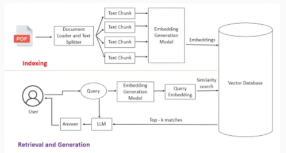
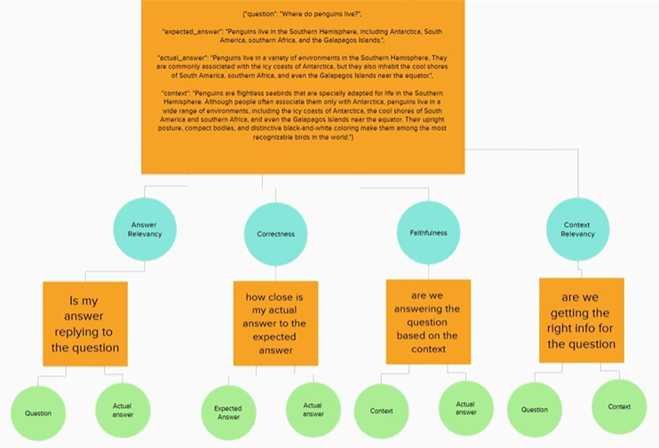

# RAG Evaluation System

> A compact evaluation lab for one RAG pipeline: ask questions about a penguin PDF, score the answers with DeepEval, and compare saved evaluation runs.


This project evaluates a single LangChain RAG pipeline against 20 question-and-answer pairs about [`pdfs/Penguins_ACL.pdf`](pdfs/Penguins_ACL.pdf). The only active RAG implementation is [`RAG1/`](RAG1/); the [`versions/`](versions/) folders are saved evaluation runs and scripts for that same pipeline. New to RAG or DeepEval? [`notes.md`](notes.md) explains the concepts behind everything here.



## Contents

- [Current Structure](#current-structure)
- [Saved Results](#saved-results)
- [How It Works](#how-it-works)
- [Evaluation Metrics](#evaluation-metrics)
- [Get Started](#get-started)
- [Run Evaluations](#run-evaluations)
- [Project Map](#project-map)
- [Known Limitations](#known-limitations)
- [Roadmap](#roadmap)

## Current Structure

The project is organized around these pieces:

| Path | Role |
|---|---|
| [`RAG1/`](RAG1/) | The only active RAG implementation |
| [`pdfs/Penguins_ACL.pdf`](pdfs/Penguins_ACL.pdf) | Source document used for retrieval |
| [`eval_dataset.jsonl`](eval_dataset.jsonl) | 20 evaluation questions with expected answers |
| [`groq_judge.py`](groq_judge.py) | DeepEval judge model backed by Groq |
| [`versions/v1/`](versions/v1/), [`versions/v2/`](versions/v2/), [`versions/v3/`](versions/v3/) | Saved evaluation runs plus runner, scorer, and summary scripts |
| [`single_tests/`](single_tests/) | Small DeepEval examples for one metric at a time |
| [`experiment_v1.jsonl`](experiment_v1.jsonl), [`experiment_v2.jsonl`](experiment_v2.jsonl), [`experiment_v3.jsonl`](experiment_v3.jsonl) | Root-level evaluation summaries |
| [`notes.md`](notes.md) | Study notes on the concepts used in this project |
| [`docs/`](docs/) | Images used in this README |

The `versions/vN` folders are not separate RAG implementations. Each runner imports the same [`RAG1.agent.ask`](RAG1/agent.py) function; only the saved run outputs and script names differ.

## Saved Results

The root evaluation summaries contain one JSON object each, despite the `.jsonl` extension. These are the checked-in averages over 20 cases:

| Summary file | Run label | Retriever `k` | Answer relevancy | Faithfulness | Context relevancy | Correctness |
|---|---|---:|---:|---:|---:|---:|
| [`experiment_v1.jsonl`](experiment_v1.jsonl) | `experiment_v1_k3` | 3 | 0.988 | 1.000 | 0.733 | 0.900 |
| [`experiment_v2.jsonl`](experiment_v2.jsonl) | `experiment_v2_k1` | 1 | 1.000 | 1.000 | 0.781 | 0.915 |
| [`experiment_v3.jsonl`](experiment_v3.jsonl) | `experiment_v3_k2` | 2 | 1.000 | 1.000 | 0.787 | 0.890 |

> **Read these numbers with care.**
> - The three runs were produced **before** [`RAG1.agent.ask`](RAG1/agent.py) was changed to return the chunks the retriever actually returned. At that point the scored `context` was text the *model* wrote, so faithfulness (exactly 1.000 in every run) and context relevancy do not measure the retriever. See [Known Limitations](#known-limitations).
> - The gaps between runs (at most 0.05, on 20 cases, scored by an LLM judge) are within normal noise. They do not show that one `k` is better than another.
>
> Re-run the pipeline to get retriever-based numbers.

## How It Works

```mermaid
flowchart LR
    PDF["pdfs/Penguins_ACL.pdf"] --> Reader["RAG1/file_reader.py"]
    Reader --> Index["RAG1/indexing.py"]
    Index --> Store["Hugging Face embeddings + InMemoryVectorStore"]
    Store --> Tool["RAG1/tools.py collecting_info"]
    Tool --> Agent["RAG1/agent.py"]
    Data["eval_dataset.jsonl"] --> Runner["versions/vN/eval_runnerN.py"]
    Agent --> Runner
    Runner --> Results["resultsN.jsonl"]
    Results --> Eval["eval_all_metricsN_fast.py"]
    Eval --> Scored["evaluated_resultsN.jsonl"]
    Scored --> Summary["evaluation_summaryN.py"]
    Scored --> Save["save_experiment.py"]
    Save --> Experiment["experiment_vN.jsonl"]
    Experiment --> Compare["compare_experiments.py"]
```



The live RAG path:

1. [`RAG1/file_reader.py`](RAG1/file_reader.py) extracts text blocks from the PDF with PyMuPDF (10 chunks for this PDF).
2. [`RAG1/indexing.py`](RAG1/indexing.py) embeds those chunks with `sentence-transformers/all-MiniLM-L6-v2`, which runs locally through `langchain_huggingface`, and stores them in a LangChain `InMemoryVectorStore`.
3. [`RAG1/tools.py`](RAG1/tools.py) exposes a retrieval tool called `collecting_info`. It runs `similarity_search(query, k=3)` and records the chunks it returned.
4. [`RAG1/agent.py`](RAG1/agent.py) builds a LangChain agent on a Groq-hosted model, lets it call the retrieval tool, and returns the structured `answer` together with the retrieved chunks as `context`.
5. The evaluation runner scripts call the same RAG over all 20 dataset rows and save JSONL output.

## Evaluation Metrics



Each metric compares two of the four ingredients of a test case: the question, the expected answer, the actual answer, and the context.

| Metric | DeepEval implementation | What it checks | Main inputs |
|---|---|---|---|
| Answer relevancy | `AnswerRelevancyMetric` | Whether the answer addresses the question | Question, actual answer |
| Faithfulness | `FaithfulnessMetric` | Whether the answer is supported by the supplied context | Actual answer, retrieval context |
| Context relevancy | `ContextualRelevancyMetric` | Whether the retrieved context is useful for the question | Question, retrieval context |
| Correctness | `GEval` | Whether the answer is factually correct against the expected answer | Actual answer, expected answer |

The metric scripts use a `0.7` threshold. The `*_fast.py` scripts batch the evaluation through `deepeval.evaluate(...)` and write the scored JSONL files.

The judge is a Groq-hosted `openai/gpt-oss-120b`, wrapped in [`groq_judge.py`](groq_judge.py). It is an open-weight model served by Groq, so no OpenAI key is needed. For how each score is computed, see [`notes.md`](notes.md#43-the-four-metrics).

## Get Started

### Requirements

| Requirement | Why |
|---|---|
| Python 3.14+ | Required by [`pyproject.toml`](pyproject.toml) |
| `uv` | Installs and runs the locked environment |
| Groq API key | Needed for answer generation and DeepEval judge calls |
| Internet access on first run | Downloads the `all-MiniLM-L6-v2` embedding model once; it then runs locally |

Install dependencies from the repository root:

```bash
uv sync
```

To inspect a saved run without making API calls:

```bash
cd versions/v2
uv run python evaluation_summary2.py
cd ../..
```

Repeat the same pattern in `versions/v1` or `versions/v3` to summarize another saved run.

## Run Evaluations

Copy [`.env.example`](.env.example) to `.env` in the repository root and fill in your key:

```env
GROQ_API_KEY=your_groq_api_key_here
```

`HUGGINGFACEHUB_API_TOKEN` is also listed in `.env.example`, but it is optional; the embedding model is public.

Run everything from the repository root with `python -m`, so the root (and with it `RAG1` and `groq_judge`) is on the import path. Running `python path/to/script.py` instead puts the script's own folder on the path and the imports fail.

Run a single metric example:

```bash
uv run --env-file .env python -m single_tests.test_single_eval_answer_relevancy
uv run --env-file .env python -m single_tests.test_single_eval_faithfulness
uv run --env-file .env python -m single_tests.test_single_eval_context_relevancy
uv run --env-file .env python -m single_tests.test_single_eval_correctness
```

Run all 20 cases with one of the saved-run script sets:

```bash
uv run --env-file .env python -m versions.v3.eval_runner3
uv run --env-file .env python -m versions.v3.eval_all_metrics3_fast
uv run python -m versions.v3.evaluation_summary3
```

Change the folder and filename number to use the `v1`, `v2`, or `v3` script set. These scripts all call the same `RAG1` pipeline. Started from the repository root, they write `resultsN.jsonl` and `evaluated_resultsN.jsonl` to the root directory, so the checked-in saved copies under `versions/vN/` are not overwritten.

To test a different retrieval size, edit the `k` value in [`RAG1/tools.py`](RAG1/tools.py):

```python
docs = vector_store.similarity_search(query, k=2)
```

Then rerun the runner, scorer, and summary scripts, and save the experiment summary with the version number and the `k` you ran:

```bash
uv run python save_experiment.py 3 2   # <version> <retriever_k>
```

This writes `experiment_v3.jsonl` in the repository root, **replacing the checked-in summary**, with the label `experiment_v3_k2` and `retriever_k: 2` taken from those two arguments. It reads `evaluated_results3.jsonl` from the current folder, and falls back to the saved copy in `versions/v3/`. Compare the saved summaries with:

```bash
uv run python compare_experiments.py
```

## Project Map

| Path | Purpose |
|---|---|
| [`RAG1/agent.py`](RAG1/agent.py) | LangChain agent and `ask(question)` entry point |
| [`RAG1/tools.py`](RAG1/tools.py) | Retrieval tool and active `k` setting |
| [`RAG1/indexing.py`](RAG1/indexing.py) | PDF chunk embedding and in-memory vector store setup |
| [`RAG1/file_reader.py`](RAG1/file_reader.py) | PDF text extraction helper |
| [`RAG1/prompts.py`](RAG1/prompts.py) | System prompt for the RAG assistant |
| [`RAG1/objects.py`](RAG1/objects.py) | Pydantic response schema |
| [`groq_judge.py`](groq_judge.py) | Custom DeepEval judge model that calls Groq |
| [`versions/v1/`](versions/v1/) | First saved evaluation run: runner, metric scripts, scored results, summary |
| [`versions/v2/`](versions/v2/) | Second saved evaluation run: runner, metric scripts, scored results, summary |
| [`versions/v3/`](versions/v3/) | Third saved evaluation run: runner, metric scripts, scored results, summary |
| [`single_tests/`](single_tests/) | Standalone DeepEval metric demos |
| [`compare_experiments.py`](compare_experiments.py) | Helper script with hard-coded comparison filenames |
| [`save_experiment.py`](save_experiment.py) | Writes an evaluation summary from evaluated results: `python save_experiment.py <version> <retriever_k>` |
| [`notes.md`](notes.md) | Study notes on the concepts used here |
| [`docs/`](docs/) | README images |
| [`main.py`](main.py) | Placeholder entry point |

## Known Limitations

- **The saved results predate the context fix.** They were scored against a `context` the model wrote itself, not against the retrieved chunks. Until the pipeline is re-run, treat faithfulness and context relevancy as unreliable. If the agent skips the retrieval tool for a question, its `context` is an empty list, so check such rows before trusting their scores.
- **Small scale.** The PDF yields only 10 chunks, so `k=3` already retrieves 30% of the document, and there are only 20 questions. Treat the results as an evaluation-design exercise rather than a broad benchmark.
- **LLM judges are noisy.** DeepEval scores come from an LLM, so reruns can differ, and small gaps between runs are not meaningful.
- **Chunks keep their line breaks.** [`RAG1/file_reader.py`](RAG1/file_reader.py) only replaces `\r`, so extracted paragraphs still contain `\n`. This is harmless for retrieval but untidy in the stored context.
- **Hard-coded filenames.** [`compare_experiments.py`](compare_experiments.py) reads fixed filenames, and the runner scripts read `eval_dataset.jsonl` from the current folder. Check input and output paths before reusing them.
- **No dashboard yet.** Results are compared with `compare_experiments.py` and the summary scripts.
- **Setup details.** The vector store is in memory and is rebuilt whenever [`RAG1/indexing.py`](RAG1/indexing.py) is imported. Runs call Groq for answers and judging, so they can take time and may hit rate limits.

## Roadmap

- Re-run the three experiments with the retrieved-context fix and refresh the saved results.
- Add `ContextualPrecisionMetric` and `ContextualRecallMetric`.
- Add questions whose answer is *not* in the PDF, to test the "not enough information" behaviour.
- Run each setting several times and report the spread, not a single number.
- Add a Streamlit dashboard for comparing saved runs.

More ideas are in [`notes.md`](notes.md#8-ideas-to-take-it-further).
