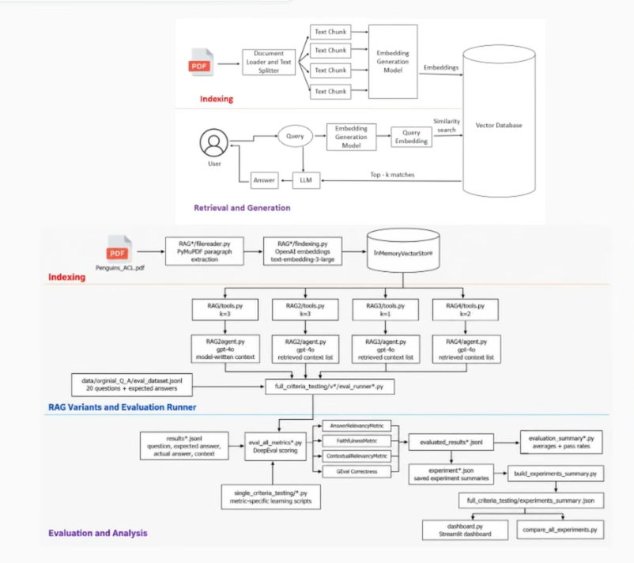
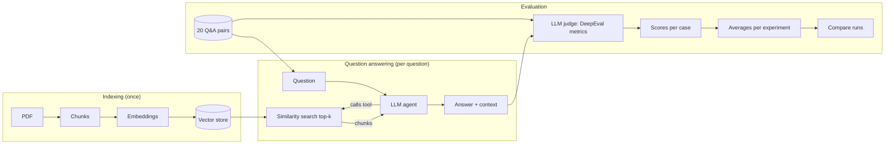
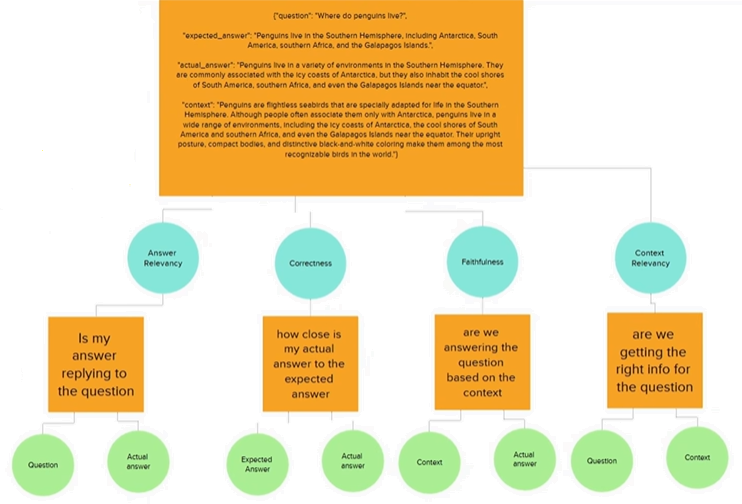

# Project Notes: Concepts Behind the RAG Evaluation System

Study notes for this repo. They explain the ideas the project uses, tie each one to the file where it shows up, and list the pitfalls found while reading the code.

**One-paragraph summary.** A 2-page PDF about penguins is split into chunks, embedded, and stored in a vector store. An LLM agent answers questions by calling a retrieval tool. A hand-written set of 20 question/answer pairs is run through the agent, and four LLM-judged metrics from DeepEval score each answer. Averages are saved per experiment so different runs can be compared.

## Contents

1. [Big picture](#1-big-picture)
2. [RAG concepts](#2-rag-concepts)
3. [How this repo implements RAG](#3-how-this-repo-implements-rag)
4. [Evaluating a RAG system](#4-evaluating-a-rag-system)
5. [Running experiments](#5-running-experiments)
6. [Tooling concepts](#6-tooling-concepts)
7. [Known pitfalls in this repo](#7-known-pitfalls-in-this-repo)
8. [Ideas to take it further](#8-ideas-to-take-it-further)
9. [Glossary](#9-glossary)
10. [Self-check questions](#10-self-check-questions)

---

## 1. Big picture



> **Reading this diagram.** The top half is generic RAG and is still accurate. The bottom half is an *earlier design* of this project, with four variants (`RAG`, `RAG2`, `RAG3`, `RAG4`), OpenAI embeddings and `gpt-4o`. The current repo keeps a single pipeline (`RAG1/`) that uses Groq and local Hugging Face embeddings (see [section 3](#3-how-this-repo-implements-rag)). The *shape* of the system, index → retrieve → generate → evaluate → compare, is unchanged.



---

## 2. RAG concepts

### 2.1 Why RAG exists

An LLM only knows what was in its training data, and it will confidently make things up (**hallucinate**) when it does not know. **Retrieval-Augmented Generation** fixes this by fetching relevant text from *your* documents at question time and putting it in front of the model, so the answer is **grounded** in a source you control. It also avoids retraining the model whenever the documents change.

### 2.2 Indexing (done once, offline)

| Step | What happens | Why |
|---|---|---|
| **Load** | Read the PDF and extract text | Models cannot read PDFs directly |
| **Chunk** | Cut the text into small pieces | Retrieval returns whole chunks, so they must be small enough to be specific and large enough to make sense alone |
| **Embed** | Turn each chunk into a vector of numbers | Similar meaning gives nearby vectors, which enables search by meaning instead of keywords |
| **Store** | Save vectors and the original text in a vector store | Fast nearest-neighbour lookup later |

- **Chunking trade-off:** small chunks are precise but lose surrounding context. Large chunks keep context but dilute the relevant part with noise. Common strategies are fixed size with overlap, sentence, paragraph and semantic splitting. This project uses **layout paragraphs** (PyMuPDF text blocks).
- **Embedding model:** a neural network that maps text to a fixed-length vector. This project uses `sentence-transformers/all-MiniLM-L6-v2`, which produces 384-dimension vectors, runs locally on CPU and needs no API key. The model also truncates long input (about 256 word-pieces), which is fine for ~430-character chunks.
- **Vector store:** a database for vectors. `InMemoryVectorStore` keeps everything in a Python dict. It is rebuilt every run and is fine for 10 chunks, but it is not persistent and does not scale. Production systems use FAISS, Chroma, pgvector, Pinecone and similar.

### 2.3 Retrieval (per question)

1. Embed the **query** with the *same* embedding model used for the chunks.
2. Compute **similarity** between the query vector and every chunk vector. **Cosine similarity** compares the angle between vectors and ignores their length. It is the standard choice, and LangChain's in-memory store uses it.
3. Return the **top-k** most similar chunks.

**`k` is the main retrieval knob:**

| Smaller k | Larger k |
|---|---|
| Less noise, higher precision | Higher recall (less chance of missing the needed chunk) |
| Risk of missing a needed chunk | More irrelevant text, so a distracted model and lower context-relevancy scores |
| Cheaper (fewer tokens) | More expensive and slower |

### 2.4 Generation

The retrieved chunks are given to the LLM together with the question and a **grounding instruction** ("answer only from the retrieved information; if it is not there, say so"). That instruction is what turns a chatty model into a source-bound one. It lives in [`RAG1/prompts.py`](RAG1/prompts.py). Setting `temperature=0` makes output as repeatable as the provider allows (not perfectly so).

### 2.5 Classic RAG vs. agentic (tool-based) RAG

- **Classic pipeline:** code *always* retrieves, pastes the chunks into the prompt, then calls the LLM once.
- **Agentic / tool-based:** retrieval is exposed as a **tool** (a function with a name, docstring and typed arguments). The model *decides* whether and how to call it, and may call it several times or rewrite the query. This repo does this: [`RAG1/tools.py`](RAG1/tools.py) defines `collecting_info`, decorated with `@tool`, and [`RAG1/agent.py`](RAG1/agent.py) builds the agent with LangChain's `create_agent`.
- **Trade-off:** the agent is more flexible, but there is one more thing that can go wrong. The model may skip retrieval, or call it with a poor query. The system prompt must also name the tool correctly (see [pitfalls](#7-known-pitfalls-in-this-repo)).

### 2.6 Structured output

Instead of free text, the agent must return an object that matches a **Pydantic** model (`Answer` in [`RAG1/objects.py`](RAG1/objects.py)) with a single `answer` field. `ask()` adds the retrieved `context` itself, so the model is never asked to write its own context (see [pitfall 1](#7-known-pitfalls-in-this-repo)).

- **`ToolStrategy(Answer)`** makes the schema look like one more tool, which the model calls to give its final answer. The code comment says this was needed because Groq rejects JSON mode combined with tool calls.
- Typed output means the evaluation scripts can read `result["answer"]` and `result["context"]` without parsing prose.
- **Pydantic** validates that the model's output has the right fields and types, and the field `description`s are shown to the model as instructions.

---

## 3. How this repo implements RAG

| Concern | Choice | File |
|---|---|---|
| PDF extraction | PyMuPDF `page.get_text("blocks")`, sorted top-to-bottom, left-to-right | [`RAG1/file_reader.py`](RAG1/file_reader.py) |
| Chunking | One block = one chunk. The PDF yields **10 chunks** of ~380–500 characters (avg ~430) | same |
| Embeddings | `sentence-transformers/all-MiniLM-L6-v2` via `langchain_huggingface`, local | [`RAG1/indexing.py`](RAG1/indexing.py) |
| Vector store | LangChain core `InMemoryVectorStore`, built when the module is imported | same |
| Retrieval | `similarity_search(query, k=3)`; every returned chunk is recorded in `last_retrieved_context` | [`RAG1/tools.py`](RAG1/tools.py) |
| Generator LLM | `ChatGroq` (Groq-hosted Qwen model), `temperature=0` | [`RAG1/agent.py`](RAG1/agent.py) |
| Output schema | Pydantic `Answer(answer)`. `ask()` returns `{"answer", "context"}`, where `context` is the list of retrieved chunks | [`RAG1/objects.py`](RAG1/objects.py), [`RAG1/agent.py`](RAG1/agent.py) |
| Judge LLM | Groq-hosted `openai/gpt-oss-120b` (20b in the single tests) via a custom wrapper | [`groq_judge.py`](groq_judge.py) |
| Dataset | 20 hand-written `question` + `expected_answer` pairs | [`eval_dataset.jsonl`](eval_dataset.jsonl) |
| Runners / scorers | `versions/vN/` scripts. All three call the same `RAG1.agent.ask` | [`versions/`](versions/) |
| One-metric demos | One file per metric with a deliberately bad example | [`single_tests/`](single_tests/) |

**Scale to keep in mind:** the whole corpus is 10 chunks, so `k=3` already retrieves 30% of the document and `k=1` retrieves 10%. This is a **learning-scale** setup. Retrieval effects that matter on a 10,000-chunk corpus are muted here.

**Groq is not OpenAI.** Groq is an inference provider that hosts open-weight models. `openai/gpt-oss-120b` is an *open-weight model published by OpenAI* that Groq serves. Calling it needs a `GROQ_API_KEY`, not an OpenAI key.

---

## 4. Evaluating a RAG system

### 4.1 Why you can't just eyeball it

A RAG answer can be wrong for different reasons, and they need different fixes:

| Failure | Where | Example |
|---|---|---|
| Retriever fetched the wrong chunks | **Retrieval** | Asked about diet, got chunks about feathers |
| Right chunks, but the model ignored or contradicted them | **Generation (groundedness)** | Context says "krill and fish", answer says "squid and seals" |
| Right facts, but the answer dodges the question | **Generation (relevance)** | Long answer about penguin habitats when asked about diet |
| Answer is fluent but disagrees with the truth | **End to end** | Plausible but factually wrong |

Evaluation gives one **metric per failure mode**, so a low number points at a component, and a change to the system can be measured instead of guessed at.

### 4.2 The test case: four ingredients, four metrics



The picture above is the whole idea in one frame. Each metric compares **two** of the four ingredients:

| Ingredient | DeepEval `LLMTestCase` field | Where it comes from |
|---|---|---|
| Question | `input` | The dataset |
| Expected answer | `expected_output` | The dataset (human-written "golden" answer) |
| Actual answer | `actual_output` | The RAG system's reply |
| Context | `retrieval_context` (list of strings) | The chunks the retriever returned for this question (`ask()["context"]`) |

> `retrieval_context` is what the *retriever* returned. DeepEval also has a separate `context` field, meaning ground-truth source text, which is used by other metrics. Don't mix them up.

### 4.3 The four metrics

All four use `threshold=0.7`. A case "passes" a metric if its score is ≥ 0.7. Scores run from 0 to 1.

| Metric (DeepEval class) | Question it answers | Compares | Needs expected answer? | Mostly diagnoses |
|---|---|---|---|---|
| **Answer Relevancy** (`AnswerRelevancyMetric`) | Is my answer replying to the question? | question ↔ actual answer | No | Generator |
| **Faithfulness** (`FaithfulnessMetric`) | Is the answer based on the context, without making things up? | context ↔ actual answer | No | Generator (hallucination) |
| **Contextual Relevancy** (`ContextualRelevancyMetric`) | Are we getting the right info for the question? | question ↔ context | No | Retriever |
| **Correctness** (`GEval`, custom criteria) | How close is the actual answer to the expected answer? | expected ↔ actual answer | **Yes** | End to end |

**How each score is produced** (the judge LLM does the reading, simple arithmetic does the score):

- **Answer Relevancy:** the judge splits `actual_output` into statements and labels each as relevant or not to `input`. Score ≈ relevant statements ÷ total statements. Rambling or off-topic sentences pull it down. It does **not** check that the answer is *true*.
- **Faithfulness:** the judge extracts *claims* from `actual_output` and *facts* from `retrieval_context`, then checks each claim against the facts. Score ≈ claims not contradicted ÷ total claims. By DeepEval's definition a claim loses points when the context *contradicts* it, so it measures consistency with the context and **not** real-world truth. A confidently wrong context still yields a "faithful" answer.
- **Contextual Relevancy:** the judge splits the retrieval context into statements and labels each as relevant to `input` or not. Score ≈ relevant statements ÷ total statements. It behaves like **precision**: extra irrelevant text lowers it, so larger `k` tends to reduce it.
- **Correctness (G-Eval):** a **custom criterion** written in plain English ("determine whether the actual output is factually correct based on the expected output"). G-Eval turns it into evaluation steps, has the judge reason through them, and returns a normalized score. `evaluation_params` controls which fields the judge sees. Here that is only `ACTUAL_OUTPUT` and `EXPECTED_OUTPUT`. G-Eval is the most flexible metric and the most subjective one.

Each has a runnable example in [`single_tests/`](single_tests/) that deliberately uses *bad* input ("Penguins primarily feed on cars", "Penguins are stupid.", "…live in Maharashtra") to confirm the metric reacts. **That is the cheapest way to sanity-check a metric: feed it something you know is wrong and see whether the score drops.**

### 4.4 Reference-free vs. reference-based

- **Reference-free** (answer relevancy, faithfulness, contextual relevancy) need no gold answer, so they work on live traffic.
- **Reference-based** (correctness) needs `expected_output`, which means someone must write answers by hand. This is the costly part of building the dataset, and a bad reference gives bad scores.

### 4.5 LLM-as-a-judge

Scoring with another LLM instead of string matching.

- **Why not BLEU/ROUGE or exact match?** They count overlapping words. Correct paraphrases ("Their streamlined bodies reduce drag…" vs. "A streamlined shape cuts water resistance…") score poorly even though they are right.
- **Costs:** non-deterministic (the same case can score slightly differently on a rerun), slower, uses API quota, and has its own biases (favours longer answers, favours its own style).
- **Mitigations:** use a *different* model as judge than as generator (here Qwen generates and gpt-oss judges), keep `temperature=0`, write narrow criteria, and spot-check the judge's `reason` text.
- **Custom judge wrapper:** DeepEval defaults to an OpenAI judge. [`groq_judge.py`](groq_judge.py) subclasses `DeepEvalBaseLLM` and implements `load_model`, `generate`, `a_generate` and `get_model_name`. DeepEval passes a Pydantic `schema` and expects an instance back, so the wrapper uses `with_structured_output(schema, method="json_schema")`. The `a_generate` method is the async version, so DeepEval can score many cases concurrently.

### 4.6 Thresholds and pass rates

- A **threshold** turns a continuous score into pass/fail (`metric.is_successful()`).
- The **average** hides the distribution. The **pass rate** (cases ≥ 0.7) is often more informative, and `evaluation_summary*.py` prints both.
- `0.7` is a convention. Pick it by looking at real examples of what you consider acceptable.

### 4.7 Reading the scores: symptom → likely cause

| Pattern | Likely cause | Things to try |
|---|---|---|
| Low contextual relevancy, good correctness | Retriever returns extra or noisy chunks, but the model copes | Lower `k`, better chunking, re-ranking |
| Low correctness, good faithfulness | Retriever missed the needed chunk, so the model faithfully answered from the wrong context | Raise `k`, better embeddings, hybrid search |
| Low faithfulness | Model adds facts not in the context | Stronger grounding prompt, lower temperature, check the context really is what was retrieved |
| Low answer relevancy | Model rambles or answers a different question | Prompt for concise answers, check query rewriting |
| Everything ≈ 1.0 | Possibly a measurement problem (see [pitfalls](#7-known-pitfalls-in-this-repo)) | Verify what is being scored |

### 4.8 `measure()` vs. `evaluate()`

- `metric.measure(test_case)` scores **one case, one metric, sequentially**. It is simple and good for demos. [`eval_all_metrics1.py`](versions/v1/eval_all_metrics1.py) loops this way.
- `deepeval.evaluate(test_cases=[...], metrics=[...])` scores a **batch concurrently**. This is why the `*_fast.py` scripts are faster, and it returns per-case `test_results` with `metrics_data`. `CacheConfig(use_cache=False, write_cache=False)` forces fresh judge calls so a rerun is not silently served from cache.

---

## 5. Running experiments

### 5.1 What an "experiment" is here

Same dataset, same judge, **one thing changed** (the retrieval `k`), then compare averages. Holding everything else fixed is what lets a difference in scores be attributed to the change.

Pipeline per run:

```
eval_dataset.jsonl ──► eval_runnerN.py ──► resultsN.jsonl           (question, expected, actual, context)
                  ──► eval_all_metricsN_fast.py ──► evaluated_resultsN.jsonl   (+ 4 scores per row)
                  ──► evaluation_summaryN.py ──► console averages and pass rates
                  ──► experiment_vN.jsonl                           (one saved summary per run)
                  ──► compare_experiments.py                        (side-by-side table)
```

### 5.2 Saved results snapshot

| Run label | answer relevancy | faithfulness | context relevancy | correctness |
|---|---:|---:|---:|---:|
| `experiment_v1_k3` | 0.988 | 1.000 | 0.733 | 0.900 |
| `experiment_v2_k1` | 1.000 | 1.000 | 0.781 | 0.915 |
| `experiment_v3_k2` | 1.000 | 1.000 | 0.787 | 0.890 |

How to read this honestly:

- The spread between runs is small (≤ 0.05 on any metric) while there are only **20 cases** and the judge is a noisy LLM. These differences are **within the noise**, so they don't establish that one `k` is better.
- A meaningful comparison would repeat each setting several times (same `k`, several runs) and look at the run-to-run variation first.
- Faithfulness is exactly 1.000 in all three runs. That is a *reason to investigate* before celebrating ([pitfall 1](#7-known-pitfalls-in-this-repo)).
- These runs **predate the context fix**, so they were scored against model-written context. The code now returns the retrieved chunks, but the saved numbers have not been re-generated. Expect faithfulness and context relevancy to change on the next run.
- The `retriever_k` values (3 / 1 / 2) follow the run labels. The summary files originally stored 3 for all three (pitfall 3).

### 5.3 Good experiment hygiene

- Change **one variable at a time** (`k`, chunk size, embedding model, prompt, generator).
- **Record the setting inside the result file** (`retriever_k` in the summary) instead of relying on the filename. `python save_experiment.py <version> <retriever_k>` now writes that field for you (pitfall 3).
- Keep the dataset **frozen** while comparing runs.
- Save raw per-case results, not only averages, so you can find *which* questions regress.
- Never tune on your whole test set and then report the same numbers as a final result. Keep some questions unseen.

---

## 6. Tooling concepts

| Concept | What it is | In this repo |
|---|---|---|
| **uv** | Fast Python package/environment manager. `uv sync` installs from `pyproject.toml` and `uv.lock`; `uv run` runs inside that environment | `pyproject.toml`, `uv.lock` |
| **`pyproject.toml`** | Declares dependencies and Python version | `requires-python = ">=3.14"` |
| **`.env` + `python-dotenv`** | Secrets live in an untracked file and are loaded into environment variables | `load_dotenv()`; `.gitignore` excludes `.env`; `.env.example` is the safe template |
| **JSONL** | JSON Lines: one JSON object per line. Easy to append and stream. Parse with `json.loads(line)` per line | datasets, `results*.jsonl` |
| **`json.load` vs `json.loads` / `json.dump` vs `json.dumps`** | No `s` = file object. With `s` = string | See pitfalls 4 and 5 |
| **Pydantic** | Data models with validation, used for structured LLM output | `RAG1/objects.py` |
| **Async vs sync** | Concurrent calls (`a_generate`) so many judge requests overlap instead of running one at a time | `GroqJudge`, `evaluate()` |
| **Module vs script execution** | `python path/to/script.py` puts *the script's folder* on the import path. `python -m package.module` puts the *current folder* on it | See pitfall 6 |
| **Namespace packages** | Folders without `__init__.py` can still be imported (`RAG1`, `versions.v3`) | Why `python -m` works here |

---

## 7. Known pitfalls in this repo

Found while reading the code. These are lessons, not blame. Each one is a realistic mistake in evaluation projects. **Status** says what has been done about it.

1. **The scored "context" was the model's text, not the retriever's output.**
   `ask()` used to return `structured_response.context`, which the LLM *wrote* into the `Answer` object. The real retrieved chunks were captured in `tools.last_retrieved_context`, which `ask()` reset but never returned. In the saved `k=3` run only 1 of 20 contexts holds more than one paragraph, although three chunks were handed to the model each time. So **faithfulness** (answer vs. a context the same model chose to quote) and **contextual relevancy** (judging the model's own snippet) were not measuring the retriever. That also explains faithfulness = 1.000 in every run. (The older diagram in `img.png` separates "model-written context" variants from "retrieved context list" variants. This is the same distinction.)
   **Status: fixed in code, not yet re-run.** `ask()` now returns `tl.last_retrieved_context`, the tool appends every chunk from every call (without repeats), and `Answer` no longer has a `context` field. The saved numbers still come from the old behaviour until the pipeline is re-run.

2. **The system prompt named the wrong tool.** `prompts.py` said `collection_info`, but the tool is `collecting_info`. The model usually recovers because the available tools are listed, but a mismatch like this can make a model skip retrieval.
   **Status: fixed.**

3. **`retriever_k` metadata was wrong.** All three `experiment_v*.jsonl` files stored `retriever_k: 3` while the labels said k3 / k1 / k2. `save_experiment.py` was hard-coded to v2, wrote the label `experiment_v2_k3` with `retriever_k: 1`, and called `json.dumps(experiment, file, …)`, which raises a `TypeError` (it should be `json.dump`).
   **Status: fixed.** The saved files now say 3 / 1 / 2, matching their labels (also the values in the old diagram and the old script). `save_experiment.py` now takes `<version> <retriever_k>`, builds the label from them and uses `json.dump`. Double-check the 1 and 2 against what you actually ran.

4. **`evaluation_summary{1,2,3}.py` used `json.load(line)` on a string.** It needs `json.loads(line)`, so the summary scripts crashed.
   **Status: fixed.**

5. **Latent row mix-up in `eval_all_metrics*_fast.py`.** The second loop built rows with `**result`, but the loop variable is `original_result`. `result` was a leftover from the first loop, so a fresh run would have written the *last* case's question, answer and context on every row while the scores belonged to the right cases. The checked-in `evaluated_results*.jsonl` files look fine (20 distinct questions), so they were generated before the script reached that state.
   **Status: fixed** (`**original_result`). `eval_all_metrics1.py` also now accepts the new list-shaped `context`.

6. **Run commands could not import the project.** Run as `python versions/v3/eval_runner3.py`, Python puts `versions/v3/` on the import path, not the repo root, so `from RAG1.agent import ask` and `from groq_judge import GroqJudge` fail. `python -m versions.v3.eval_runner3` from the repo root works.
   **Status: fixed in the README**, which now uses `python -m`.

7. **Paragraph cleanup regex targets the wrong character.** `file_reader.py` says it replaces line breaks with spaces but only substitutes `\r`. All 10 extracted chunks still contain `\n` inside paragraphs.
   **Status: left as is, on purpose.** Changing the chunk text changes the embeddings and so the retrieval. Do it as its own experiment rather than mixing it into another change.

8. **Tiny corpus and sample.** 10 chunks, 20 questions. Treat results as a demonstration of the *method*, not a benchmark.
   **Status: inherent to the project.**

9. **Cosmetic bug in `compare_experiments.py`.** The header prints `k1=` and the last column uses a signed format (`+.2f`) while the others do not.
   **Status: not changed.**

---

## 8. Ideas to take it further

- Re-run the three experiments now that pitfall 1 is fixed: expect faithfulness and context relevancy to move, and that gives you a more honest baseline.
- Add **`ContextualPrecisionMetric`** and **`ContextualRecallMetric`** (also in DeepEval). Recall uses the expected answer to check whether the retriever fetched *everything needed*, which contextual relevancy does not.
- **Retrieval-only metrics** that need no LLM: check whether the chunk containing the answer is in the top-k (hit rate / recall@k, MRR). This requires labelling the gold chunk for each question.
- Try **chunk size / overlap**, a **re-ranker**, **hybrid search** (BM25 + vectors) and **query rewriting**.
- Add **negative questions** whose answer is *not* in the PDF, to test that the grounding prompt makes the model say "not enough information" instead of guessing.
- Run each setting **3–5 times** and report mean ± spread.
- Track experiments with a single results file that stores the full config (model, `k`, chunking, prompt version) next to the scores.

---

## 9. Glossary

| Term | Meaning |
|---|---|
| **RAG** | Retrieval-Augmented Generation: retrieve relevant text, then generate an answer grounded in it |
| **Chunk** | A small piece of a document that is embedded and retrieved as a unit |
| **Embedding** | A vector that represents the meaning of a text |
| **Vector store / database** | Storage that finds the vectors nearest to a query vector |
| **Cosine similarity** | Similarity measured by the angle between two vectors |
| **Top-k / `k`** | How many nearest chunks to return |
| **Grounding** | Constraining the answer to provided source text |
| **Hallucination** | Fluent output that is not supported by the source or by reality |
| **Agent / tool calling** | An LLM that can choose to call functions (like retrieval) and use their results |
| **Structured output** | Forcing the LLM to return data matching a schema |
| **LLM-as-a-judge** | Using an LLM to grade another LLM's output |
| **G-Eval** | An LLM-judge method driven by a plain-English criterion |
| **Golden / reference answer** | A human-written correct answer used for comparison |
| **Test case** | One input with its actual output, optional expected output and context |
| **Threshold** | The score at or above which a case counts as passed |
| **Precision / recall (retrieval)** | Precision: how much of what was retrieved is useful. Recall: how much of what is useful was retrieved |
| **JSONL** | One JSON document per line |

---

## 10. Self-check questions

1. Why must the query be embedded with the *same* model as the chunks?
2. What changes in the trade-off when `k` goes from 1 to 3? Which metric should move first, and in which direction?
3. Faithfulness is 1.0 but correctness is 0.6. What does that pattern suggest, and which component do you investigate?
4. Why does faithfulness *not* tell you the answer is true?
5. Which of the four metrics would still work in production, where no expected answer exists?
6. What is the difference between `retrieval_context` and the model-written `context` that the saved runs used, and why does it matter for what the scores mean?
7. Why use a different model as judge than as generator?
8. With 20 cases and a noisy judge, how would you decide whether a 0.03 difference between two runs is real?
9. Why does `python versions/v3/script.py` fail to import `RAG1` while `python -m versions.v3.script` works?
10. Give one question you would add to the dataset to test the "I don't know" behaviour.
